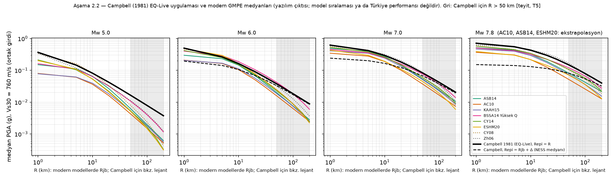

# GMPE Türkiye — Aşama 2, adım 2: Campbell (1981) EQ-Live uygulaması ile modern GMPE'lerin karşılaştırması

Tarih: 2026-11-02. Dal: `gmpe-turkiye-methodology`. Yöntem belgesi: `../YONTEM.md`. Önceki adım: `../asama2_adim1/RAPOR.md` (kapatıldı).

**Kapsam.** Yalnız analiz çıktısı. Mevcut Campbell katmanı, `index.html` ve `data/` değişmedi; EQ-Live entegrasyonu ve model seçimi bu adımın kapsamında değil.
- Sonuçlar bir **model sıralaması** ya da **Türkiye performans değerlendirmesi** değildir; yalnız aynı girdilerde medyan farkını betimler.
- Kayıt verisi kullanılmadı.

## Koşullar (kullanıcı, 2026-11-02) ve uygulanışı

| No | Koşul | Uygulama |
|---|---|---|
| 1 | Campbell, mevcut EQ-Live uygulamasının aynısı | `Campbell1981EQLive`; adım 1'de `build_hazard_grid.py` ile fark 0 |
| 2 | Campbell'ın dış merkez uzaklığı Rjb ile eşdeğer sayılmaz | İki çerçeve ayrı: **A** — nokta kaynak temsili (aynı sayısal R; yalnız kaynak bir nokta kabul edilirse geçerli); **B** — uzaklık tanımı farkı dahil, temsili: saha kırığa Rjb = R uzaklıkta, Campbell katmandaki gibi Repi = R + Δ(Mw) alır; Δ = NESS 2.1'de Repi − Rjb medyanı (YONTEM.md §13: 4,2 / 6,9 / 11,0 / 12,6 / 47,8 km). Geometri belirsizliği ve Δ'nın dağılımı dahil değil; Mw 5 için NESS verisi yok |
| 3 | Campbell'ın sınırları T5'e kadar işaretli | Bütün Campbell hücreleri **[teyit]**; yaklaşık veri aralığı dışında (M > 7,7 ya da R > 50 km) **ᵉ[teyit]** |
| 4 | Medyan ve belirsizlik ayrı | Oranlar yalnız medyandır; σ ayrı tabloda (Tablo 3). Campbell'da σ hesaplanmaması belirsizliğin sıfır olduğu anlamına gelmez; yalnız mevcut katmanda bu bileşenin hesaplanmadığını gösterir |
| 5 | Ekstrapolasyon işaretleri | **ᵉ**: modelin yayımlanmış veri aralığı dışında (AC10, ASB14 Mw > 7,6; ESHM20 temel model Mw > 7,4). **?**: KAAH15, aralık doğrulanmadı (T1) |
| 6 | Sıralama / performans değil | Liste B için tek tek değerler ve aralık (en küçük–en büyük) verilir; ortalama ya da ağırlık yok |

Ortak girdiler: doğrultu atımlı, düşey düzlem, ztor = 0 (Rrup = Rx = Rjb), odak derinliği 10 km, Vs30 = 760 m/s. Bu Vs30 ortak girdidir, bütün modellerin referans kayası değildir; Campbell'da zemin terimi yoktur. Vs30 = 360 m/s sonuçları (yalnız modern modeller) CSV'de.

### Tablo 1 — PGA (g), Vs30 = 760 m/s: Campbell (A, B) ve Liste B aralığı

| Mw | R (km) | Campbell, A: Repi = R | Campbell, B: Repi = Rjb + Δ | Liste B medyan aralığı (en küçük–en büyük) | Oran A (Liste B / Campbell A) | Oran B (Liste B / Campbell B) |
|---|---|---|---|---|---|---|
| 5,0 | 1 | 0,368 [teyit] | —  | 0,078–0,213 | 0,21–0,58 | — |
| 5,0 | 10 | 0,081 [teyit] | —  | 0,036–0,065 | 0,45–0,80 | — |
| 5,0 | 30 | 0,028 [teyit] | —  | 0,0090–0,020 | 0,32–0,72 | — |
| 5,0 | 50 | 0,016 [teyit] | —  | 0,0043–0,011 | 0,26–0,65 | — |
| 5,0 | 100 | 0,0079 ᵉ[teyit] | —  | 0,0015–0,0040 | 0,19–0,51 | — |
| 5,0 | 200 | 0,0037 ᵉ[teyit] | —  | 0,0003–0,0012 | 0,08–0,31 | — |
| 6,0 | 1 | 0,498 [teyit] | 0,195 [teyit] | 0,206–0,481 | 0,41–0,96 | 1,06–2,47 |
| 6,0 | 10 | 0,163 [teyit] | 0,106 [teyit] | 0,105–0,187 | 0,64–1,15 | 0,99–1,77 |
| 6,0 | 30 | 0,062 [teyit] | 0,051 [teyit] | 0,031–0,071 | 0,49–1,15 | 0,60–1,40 |
| 6,0 | 50 | 0,038 [teyit] | 0,033 ᵉ[teyit] | 0,016–0,042 | 0,42–1,12 | 0,48–1,28 |
| 6,0 | 100 | 0,018 ᵉ[teyit] | 0,017 ᵉ[teyit] | 0,0063–0,018 | 0,34–0,98 | 0,37–1,05 |
| 6,0 | 200 | 0,0088 ᵉ[teyit] | 0,0085 ᵉ[teyit] | 0,0022–0,0060 | 0,25–0,67 | 0,26–0,70 |
| 7,0 | 1 | 0,621 [teyit] | 0,241 [teyit] | 0,346–0,534 | 0,56–0,86 | 1,43–2,21 |
| 7,0 | 10 | 0,294 [teyit] | 0,165 [teyit] | 0,189–0,272 | 0,64–0,93 | 1,14–1,64 |
| 7,0 | 30 | 0,131 [teyit] | 0,096 [teyit] | 0,065–0,116 | 0,50–0,89 | 0,68–1,21 |
| 7,0 | 50 | 0,083 [teyit] | 0,067 ᵉ[teyit] | 0,037–0,075 | 0,45–0,91 | 0,55–1,13 |
| 7,0 | 100 | 0,042 ᵉ[teyit] | 0,037 ᵉ[teyit] | 0,017–0,037 | 0,39–0,88 | 0,45–0,99 |
| 7,0 | 200 | 0,021 ᵉ[teyit] | 0,019 ᵉ[teyit] | 0,0059–0,014 | 0,29–0,68 | 0,31–0,72 |
| 7,6 | 1 | 0,689 [teyit] | 0,132 [teyit] | 0,370–0,569 | 0,54–0,83 | 2,81–4,33 |
| 7,6 | 10 | 0,394 [teyit] | 0,113 ᵉ[teyit] | 0,210–0,321 | 0,53–0,82 | 1,86–2,84 |
| 7,6 | 30 | 0,196 [teyit] | 0,086 ᵉ[teyit] | 0,082–0,156 | 0,42–0,79 | 0,95–1,81 |
| 7,6 | 50 | 0,129 [teyit] | 0,069 ᵉ[teyit] | 0,049–0,107 | 0,38–0,83 | 0,70–1,55 |
| 7,6 | 100 | 0,068 ᵉ[teyit] | 0,046 ᵉ[teyit] | 0,024–0,057 | 0,35–0,84 | 0,51–1,23 |
| 7,6 | 200 | 0,034 ᵉ[teyit] | 0,027 ᵉ[teyit] | 0,011–0,023 | 0,31–0,68 | 0,39–0,85 |
| 7,8 | 1 | 0,712 ᵉ[teyit] | 0,151 ᵉ[teyit] | 0,367–0,579 | 0,52–0,81 | 2,42–3,82 |
| 7,8 | 10 | 0,429 ᵉ[teyit] | 0,131 ᵉ[teyit] | 0,217–0,341 | 0,51–0,79 | 1,66–2,60 |
| 7,8 | 30 | 0,223 ᵉ[teyit] | 0,100 ᵉ[teyit] | 0,085–0,172 | 0,38–0,77 | 0,85–1,71 |
| 7,8 | 50 | 0,148 ᵉ[teyit] | 0,081 ᵉ[teyit] | 0,052–0,120 | 0,35–0,81 | 0,64–1,49 |
| 7,8 | 100 | 0,079 ᵉ[teyit] | 0,054 ᵉ[teyit] | 0,026–0,066 | 0,32–0,83 | 0,47–1,21 |
| 7,8 | 200 | 0,040 ᵉ[teyit] | 0,032 ᵉ[teyit] | 0,013–0,027 | 0,32–0,69 | 0,40–0,86 |

### Tablo 2 — Model başına oran (model medyanı / Campbell A), Vs30 = 760 m/s

| Model | Mw 6,0, R 10 | Mw 6,0, R 100 | Mw 7,8, R 10 | Mw 7,8, R 100 | Mw 7,8, R 200 |
|---|---|---|---|---|---|
| ASB14 | 0,89 | 0,41 | 0,74 ᵉ | 0,53 ᵉ | 0,54 ᵉ |
| AC10 | 0,64 | 0,34 | 0,51 ᵉ | 0,32 ᵉ | 0,32 ᵉ |
| KAAH15 | 0,69 ? | 0,40 ? | 0,68 ? | 0,45 ? | 0,39 ? |
| BSSA14 Yüksek Q | 1,15 | 0,98 | 0,74 | 0,83 | 0,69 |
| CY14 | 0,92 | 0,48 | 0,79 | 0,72 | 0,55 |
| ESHM20 | 1,01 | 0,47 | 0,51 ᵉ | 0,45 ᵉ | 0,32 ᵉ |
| CY08 | 1,02 | 0,49 | 0,80 | 0,66 | 0,47 |
| Zh06 | 0,98 | 0,68 | 1,04 | 0,95 | 0,60 |

### Tablo 3 — σ_ln (ayrı; Campbell'da hesaplanmıyor), Vs30 = 760 m/s, R = 30 km

| Model | Mw 5 | Mw 6 | Mw 7 | Mw 7,8 |
|---|---|---|---|---|
| ASB14 | 0,71 | 0,71 | 0,71 | 0,71 |
| AC10 | 0,83 | 0,83 | 0,83 | 0,83 |
| KAAH15 | 0,73 | 0,73 | 0,57 | 0,57 |
| BSSA14 Yüksek Q | 0,70 | 0,61 | 0,61 | 0,61 |
| CY14 | 0,75 | 0,62 | 0,55 | 0,55 |
| ESHM20 | 0,74 | 0,67 | 0,64 | 0,64 |
| CY08 | 0,67 | 0,60 | 0,52 | 0,52 |
| Zh06 | 0,68 | 0,68 | 0,68 | 0,68 |
| Campbell 1981 (EQ-Live) | hesaplanmıyor | hesaplanmıyor | hesaplanmıyor | hesaplanmıyor |

Tablo notları:
- Tablo 1'deki Liste B aralığı, ekstrapolasyon hücrelerini (Mw > 7,4 ESHM20; Mw > 7,6 AC10, ASB14) ve KAAH15'in "?" hücrelerini de içerir; model başına işaretler Tablo 2 ve CSV'dedir.
- Oran < 1: model medyanı Campbell'dan düşük; > 1: yüksek.
- Bütün değerler `campbell_karsilastirma.csv` dosyasında: 8 model × 5 Mw × 10 R × 2 Vs30 = 800 satır; her satırda iki çerçeve ve işaretler.

## Betimsel gözlemler (sıralama ya da performans değil)

1. **Uzaklıkla azalma farkı (çerçeve A).** Aynı sayısal R'de Liste B medyanları çoğu hücrede Campbell'ın altında. Oran uzaklıkla düşüyor:
   - Mw 6: 10 km'de 0,64–1,15 → 200 km'de 0,25–0,67;
   - Mw 7,8: 10 km'de 0,51–0,79 → 200 km'de 0,32–0,69.

   Campbell'ın uygulanan biçiminde uzaklık terimi yalnız geometrik yayılımdır (−1,09 ln R; soğrulma terimi yok). Bu nedenle R > 50 km'de, yani Campbell'ın yaklaşık veri aralığı dışında **[teyit]**, Campbell medyanı modern modellerin 1,4–4 katına çıkıyor.
2. **Uzaklık tanımı farkı (çerçeve B).** Büyük depremlerde dış merkez uzaklığı kırığa olan uzaklıktan çok büyük. Campbell'a katmandaki gibi Repi verildiğinde yakın alanda değer düşüyor:
   - Mw 7,8, Rjb = 10 km: Liste B medyanları Campbell'ın 1,66–2,60 katı;
   - Mw 7,6, Rjb = 1 km: 2,81–4,33 katı;
   - uzak alanda (200 km) Campbell yine yüksek kalıyor (oran 0,40–0,86).

   Yani mevcut katmanda iki etki **uzaklığa göre zıt yönde** çalışıyor: yakın alanda dış merkez uzaklığı nedeniyle düşük, uzak alanda yavaş azalma nedeniyle yüksek. Bu bir girdi senaryosu farkıdır (YONTEM.md §6, fark türü a); bir GMPE artığı değildir.
3. **Küçük büyüklük (Mw 5).** Campbell bütün uzaklıklarda Liste B'nin üstünde (oran ≤ 0,80; 200 km'de 0,08–0,31). Campbell'ın büyüklük ölçeği M < 6 için ML'dir **[teyit, T5]**. EQ-Live ise katmana çoğunlukla mb girmektedir (YONTEM.md §1). Bu ikinci bir ölçek uyumsuzluğudur ve burada ayrıca ölçülmedi.
4. **Model aralığı Campbell farkıyla aynı büyüklükte.** Liste B'nin kendi içindeki yayılım, Mw 6 ve 10 km'de 0,105–0,187 g (yaklaşık 1,8 kat). Bu, Campbell ile modern modeller arasındaki farkla karşılaştırılabilir düzeyde. Tek bir modern modelin Campbell'ın yerine konması bu epistemik aralığı gizler (YONTEM.md §6).
5. **σ.** Modern modellerde σ_ln 0,52–0,83 (Tablo 3). Örnek: σ = 0,7 için 16.–84. yüzdelik aralığı medyanın yaklaşık 0,5 ile 2 katı arasıdır. Campbell'da bu bileşen hesaplanmıyor.

## Sınırlar

- Çerçeve B'deki Δ, NESS 2.1'in Mw sınıfı medyanıdır. Gerçek bir olayda Δ istasyonun kırığa göre konumuna bağlıdır ve geniş bir dağılımı vardır (YONTEM.md §13: 90. yüzdelik Mw ≥ 7,5'te 174 km). Bu nedenle B yalnız **temsili** bir senaryodur.
- Izgara yalnız doğrultu atımlı, düşey düzlem ve ztor = 0 içerir. Ters ve normal faylanma ile asılı blok etkileri burada yok.
- Sonuçlar PGA içindir; Campbell yalnız PGA tanımlar.
- Campbell'ın veri aralığı ve büyüklük ölçeği T5 kapanana kadar doğrulanmamış (bütün hücreler [teyit]).

## Yeniden üretim

`<oqenv>/bin/python campbell_karsilastirma.py` → `campbell_karsilastirma.csv`, `campbell_karsilastirma.json`, `campbell_karsilastirma_sekil.png`.
Ortam: openquake.engine 3.26.2, matplotlib 3.11.2. Δ değerleri NESS 2.1 dosyasından (SHA-256 `25293fe1…628b`, YONTEM.md §13).
